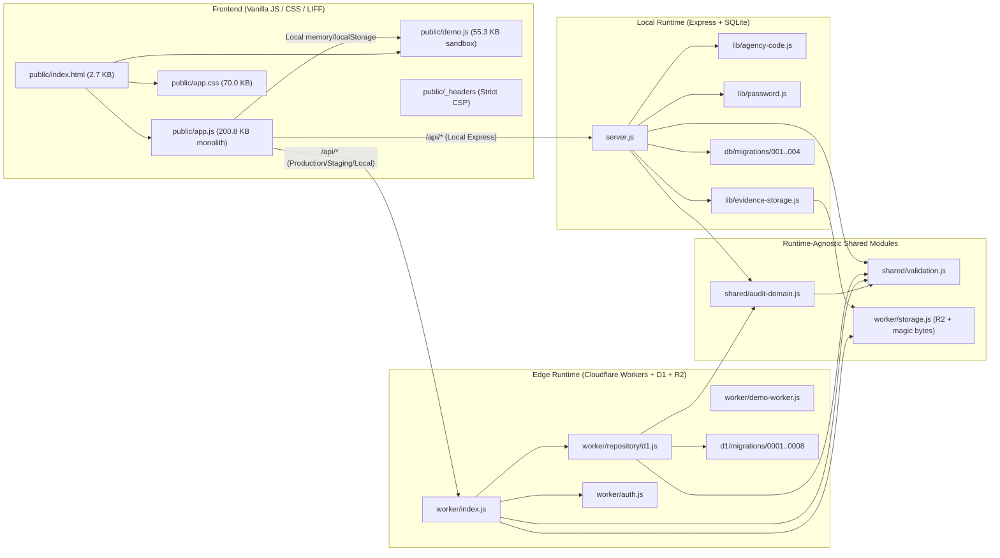

# PakMaii (Ready to Grow) — Architecture & Incremental Refactoring Guide

เอกสารนี้อธิบายสถาปัตยกรรมปัจจุบัน แผนผังการพึ่งพาระหว่างโมดูล (Dependency Map) ความเสี่ยงเชิงโครงสร้าง ข้อจำกัดของสภาพแวดล้อม LINE LIFF บน iOS/Android และแผน Refactoring แบบทีละก้าวเล็กที่ปลอดภัย

---

## 1. Dependency Map (โครงสร้างและการพึ่งพาระหว่างโมดูล)

### สินทรัพย์โค้ดหลัก (ตรวจสอบจากขนาดไฟล์จริง)

| Layer | ไฟล์ / ไดเรกทอรี | บทบาทปัจจุบัน |
|---|---|---|
| **Frontend** | `public/index.html` (2.7 KB), `public/_headers` (596 B) | Shell HTML ปลอด inline script/style + Strict CSP (`font-src 'self' data:`) |
| **Frontend Monolith** | `public/app.js` (200.8 KB), `public/app.css` (70.0 KB) | UI ทุกบทบาท (Farmer, ICS, Admin), auth/LIFF, photo capture, CSV/Print, design tokens |
| **Client Demo Sandbox** | `public/demo.js` (55.3 KB), `worker/demo-worker.js` (2.2 KB) | Sandbox แยกจาก D1 จริงทั้งหมด ไม่สามารถแตะ `/api/admin/*` |
| **Shared Pure ESM** | `shared/validation.js`, `shared/audit-domain.js` | `HttpError`, กติกาตรวจ input, domain constants, risk/audit formatters ร่วมทั้งสอง runtime |
| **Storage Abstraction** | `worker/storage.js` (3.1 KB) → `lib/evidence-storage.js` (2.2 KB) | Magic-byte check (JPEG/PNG/WebP ≤ 5 MB) + R2 / Private local disk |
| **Workers + D1** | `worker/index.js`, `worker/repository/d1.js`, `worker/auth.js` | HTTP router, LINE ID token verification, HMAC lookup, D1 batched mutations |
| **Express + SQLite** | `server.js`, `lib/*.js`, `db/migrate.js` | Express API + scrypt admin password (localhost), local SQLite migrations |
| **Database Migrations** | `d1/migrations/0001..0008`, `db/migrations/001..004` | Schema, guards, auth limits, photo evidence, ICS audit assistant |

---

## 2. Highest-Risk Modules (การจัดอันดับจุดเสี่ยงทางสถาปัตยกรรม)

| ลำดับ | โมดูล / พื้นที่ | ระดับความเสี่ยง | สาเหตุและผลกระทบหลัก |
|---|---|---|---|
| **1** | `public/app.js` | **สูงมาก (Critical)** | Monolith ขนาด ~200 KB (~3,676 บรรทัดก่อนแยก) ผูก state ส่วนกลาง (`token`, `me`, `plots`, `tab`, `demoUser`, `config`), icon/DOM helpers, auth, Farmer 3-step wizard, ICS Audit Assistant และ Admin เข้าด้วยกัน; `test/frontend-security.test.js` ยังตรวจ regex บนข้อความไฟล์ `public/app.js` โดยตรง |
| **2** | `server.js` + Local SQLite ABI | **สูง (High)** | รวม HTTP middleware, rate limit, auth, validation, RBAC และ raw SQL ไว้ในไฟล์เดียว ทำให้แยก test ยาก; บน Node v26.13.0 ไม่มี prebuilt `better_sqlite3.node` จึงรัน SQLite test suite (`api.test.js`, `worker-contract.test.js`, ฯลฯ) ไม่ได้จนกว่าจะใช้ Node 20/22 LTS |
| **3** | Dual-Runtime Divergence (`server.js` vs `worker/*`) | **ปานกลาง-สูง** | เดิม validation และ domain mappers ถูก copy ไว้ทั้ง 2 ฝั่ง (บรรเทาแล้วใน Step 1 ด้วย `shared/validation.js` และ `shared/audit-domain.js`) แต่ SQL queries และ edge route definitions ยังอยู่แยกกัน |
| **4** | `public/app.css` | **ปานกลาง (Medium)** | ~3,200 บรรทัดรวม tokens, layout, components, `@media print` และยังมีคลาสเก่าที่ไม่ได้ใช้บางส่วน; เสี่ยง conflict เวลาเพิ่มหน้าจอ Phase 4–5 |
| **5** | Missing Browser E2E & Real-Device LIFF Verification | **ปานกลาง-สูง** | ยังไม่มี Playwright test สำหรับ end-to-end ในเบราว์เซอร์ และยังไม่มีผลการทดสอบจริงบน LINE LIFF iOS/Android |
| **6** | Workspace Editor / OneDrive Sync | **ปฏิบัติการ (Operational)** | การเปิดไฟล์ค้างไว้ใน Editor พร้อมสลับ branch หรือมี OneDrive sync อาจทำให้ buffer เก่าเขียนทับไฟล์บนดิสก์ (ตรวจพบและแก้ไขแล้วระหว่างเตรียม Demo deploy) |

---

## 3. ข้อกำหนดความเข้ากันได้กับ LINE LIFF (iOS & Android)

การปรับปรุง Frontend และ Architecture ต้องปฏิบัติตามข้อจำกัดของ LINE In-App Browser (WKWebView บน iOS และ Android WebView) อย่างเคร่งครัด:

1. **ห้ามสมมติว่ามี Service Worker หรือ Background Sync:** LINE LIFF WebView บน iOS/Android มีข้อจำกัดและการล้างสถานะที่แตกต่างจากเบราว์เซอร์ปกติ จึงไม่ใช้ Service Worker caching หรือ Background Sync และต้องจัดการเครือข่ายที่ไม่เสถียรด้วยการแสดงสถานะโหลดที่ชัดเจน, ป้องกันการกดส่งซ้ำ (disabled submit state) และปุ่ม `ลองใหม่อีกครั้ง` ใน UI
2. **ห้ามพึ่งพา `blob:` URL กับ `` ภายใต้ Strict CSP:** ใช้ `FileReader.readAsDataURL()` (`blobToDataUrl`) เพื่อแสดงตัวอย่างและภาพจาก private `/api/evidence/:id/content` ให้สอดคล้องกับ `img-src 'self' data: https:`
3. **การถ่ายภาพและเลือกไฟล์ใน LIFF:** รองรับ `<input capture="environment">` ควบคู่กับปุ่มเลือกจากคลังภาพปกติ เผื่อกรณี WebView บางรุ่นจำกัดการเปิดกล้องโดยตรง และย่อขนาดภาพฝั่ง client ก่อนส่ง
4. **Session & Auth Resilience:** รักษา `liff.init()` แบบ idempotent (`ensureLiff()` ครั้งเดียวด้วย `liffInitPromise`), เก็บ Bearer token ใน `sessionStorage` และป้องกัน redirect loop ด้วยธง `logged_out`
5. **Viewport & Touch:** ใช้ `viewport-fit=cover`, safe-area padding (`env(safe-area-inset-bottom)`) และขนาดปุ่ม/input ไม่น้อยกว่า 44px

---

## 4. แผน Incremental Refactoring Roadmap

| Step | เป้าหมาย | สถานะ | ขอบเขตและข้อควรระวัง |
|---|---|---|---|
| **Step 1** | **Extract Shared Validation & Audit Domain (`shared/validation.js`, `shared/audit-domain.js`)** | **เสร็จแล้ว** | แยก validation, `HttpError`, constants และ risk/audit formatters ออกจาก `worker/index.js`, `worker/repository/d1.js`, `server.js`; เพิ่ม `test/shared-contract.test.js` และตรวจ `wrangler deploy --dry-run` |
| **Step 2** | Split Frontend Core (`public/js/core/{dom,icons,api,auth}.js`) + preserve `frontend-security.test.js` | แผนถัดไป | เปลี่ยน `<script defer src="/app.js">` เป็น `<script type="module" src="/js/main.js">`, อัปเดต `public/_headers` (ยังคง `'self'`), อัปเดต `frontend-security.test.js` ให้ตรวจทุกไฟล์ใน `public/js/` |
| **Step 3** | Split Frontend Views by Role (`public/js/farmer/*`, `ics/*`, `admin/*`, `shared/*`) | รอดำเนินการ | ย้าย Farmer Wizard, ICS Split-View/Audit Assistant, Admin Overview, Lot Passport เข้าเป็นโมดูลย่อย |
| **Step 4** | Modularize `public/app.css` into ordered `@import` partials (`tokens`, `layout`, `components`, `roles`, `print`) | รอดำเนินการ | แยก section ชัดเจน, ยืนยัน CSP `style-src 'self'` โหลด stylesheet ย่อยได้ทั้งหมด และคงกฎ 0 `linear-gradient` + `tabular-nums` |
| **Step 5** | Decompose `server.js` into Express `routes/` and SQLite `repositories/` parity | รอดำเนินการ | ย้าย route handlers และ queries ใน `server.js` ให้โครงสร้างตรงกับ `worker/repository/d1.js` |
| **Step 6** | Expand Dual-Runtime Contract Tests & Playwright E2E Suite | รอดำเนินการ | รัน `test/worker-contract.test.js` บน Node 20/22 LTS ควบคู่ Worker + Playwright E2E (Demo mode + Local Express + LIFF viewport emulation) |
