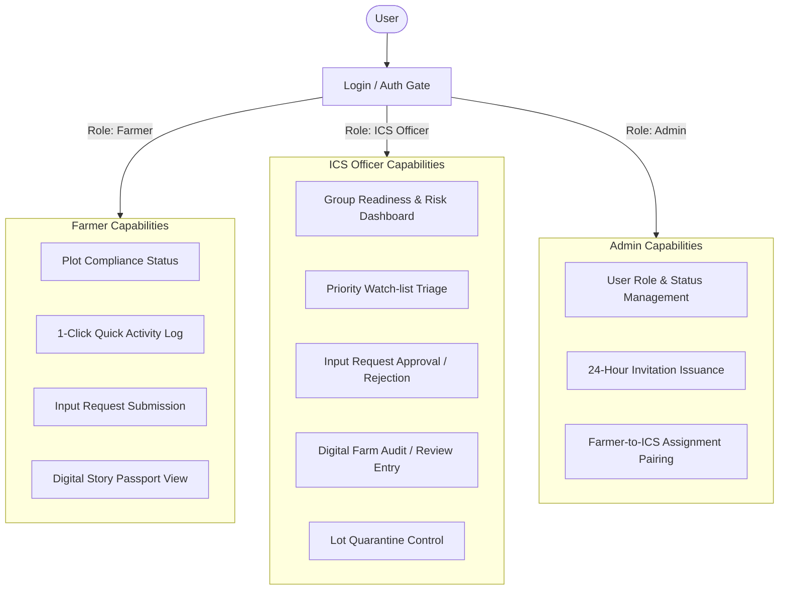

# UI/UX Redesign Audit & Implementation Plan
**Project:** PakMaii / Ready to Grow (Internal Control System — ICS & PGS Organic Compliance)  
**Date:** 2026-11-06  
**Auditor:** Senior Product Designer & UI/UX Architect  
**Visual Direction:** Premium AgriTech — Natural Forest Green (`#245B45`), Deep Forest (`#183F32`), Sage Green (`#8BA88E`), Warm Ivory (`#F7F6EF`), Surface White (`#FFFFFF`), Soft Sage (`#EDF2EB`), and Elegant Minimalism.

---

## 1. Existing Architecture & Rendering Approach

### 1.1 Technology Stack & Rendering Model
- **Client-Side Framework:** Zero-dependency Vanilla JavaScript (`public/app.js`), DOM-safe builder functions (`el()`, `icon()`, `dataForm()`, `card()`).
- **No Virtual DOM / SPA Framework:** Direct DOM manipulation via standard Web APIs. No React, Vue, or Angular.
- **Security & CSP Constraints:**
  - Content Security Policy (CSP): `default-src 'none'; script-src 'self' https://static.line-scdn.net; style-src 'self'; font-src 'self' data:; connect-src 'self' ...`
  - Strict prohibition against inline styles (`style="..."` attribute or `<style>` tags). All styles must live in `public/app.css`.
  - Strict prohibition against DOM HTML injection sinks (`innerHTML`, `outerHTML`, `document.write`, `eval`, `new Function`). All dynamic API strings are rendered strictly as DOM text nodes.
- **Dual Execution Modes:**
  1. **Public Demo Mode (`wrangler.demo.jsonc` & `public/demo.js`):** Client-side mock database simulating SQLite/D1 in memory/sessionStorage. Provides instant interactive evaluation without live backend secrets.
  2. **Production / Staging Cloudflare Worker (`wrangler.jsonc` & `worker/`):** Full D1 SQLite database, HMAC token signing, LINE Login via LIFF SDK, and authenticated REST APIs under `/api/*`.

---

## 2. Page & Navigation Inventory

| Page / Route ID | Title | Target Roles | Key Functionality |
| :--- | :--- | :--- | :--- |
| **Login / Auth** | เข้าสู่ระบบทดลองใช้งาน / Admin Login | All (Farmer, ICS, Admin) | Role selection (`farmer`, `ics`), Demo code entry (`demoCode`), Admin LINE/Password login link, error handling. |
| **Registration** | ลงทะเบียนครั้งแรก | Unlinked Farmer / ICS | Invitation token input, LINE identity binding, agency code verification. |
| **Farmer: `home`** | ภาพรวมแปลงปลูก | Farmer | PGS Organic Compliance Traffic-Light Card (Normal, Warn, Risk), days-since-last-log counter, quick stats, direct action triggers. |
| **Farmer: `plots`** | แปลงปลูกของฉัน | Farmer | Plot list, crop details, conversion year status, inline plot edit form, add plot form. |
| **Farmer: `record`** | บันทึกกิจกรรมในแปลง | Farmer | Daily Farm Log, 8 Categorized Quick Preset Chips, plot selector, activity type, date, Speech-to-Text mic, photo proof uploader, activity history. |
| **Farmer: `approval`** | คำขอปัจจัยการผลิต | Farmer | Form to request approved organic fertilizers/biopesticides with formula chips, request status history. |
| **Farmer: `reviews`** | ผลตรวจแปลง | Farmer | Internal audit history, inspection results, compliance scores, inspector recommendations. |
| **Farmer / ICS: `lots`**| ล็อตผลผลิต & Story Passport | Farmer, ICS | Production lots, harvest date, estimated weight, certification status, QR Story Passport overlay, lot quarantine control (ICS). |
| **ICS: `home`** | ภาพรวมระบบควบคุมภายใน (ICS) | ICS Officer | Group readiness KPI (%), risk alerts count, pending input requests, Priority Watch-list table/cards. |
| **ICS: `farmers`** | เกษตรกรในความรับผิดชอบ | ICS Officer (Demo) | List of farmers assigned to the officer, plot counts, last activity date, pending review badges. |
| **ICS: `plots`** | แปลงเกษตรกรทั้งหมด | ICS Officer | Overview of member plots, status tracking, buffer zone notes. |
| **ICS: `record`** | กิจกรรมสมาชิก | ICS Officer | Stream of agricultural activities submitted by member farmers. |
| **ICS: `approval`** | พิจารณาคำขอปัจจัย | ICS Officer | Triage queue for fertilizer/input requests, approval/rejection forms with reasoning and audit trail. |
| **ICS: `risks`** | เฝ้าระวังความเสี่ยง | ICS Officer | Non-compliance risk table, overdue logging flags (>14 days), plot-level severity badges. |
| **ICS: `reviews`** | ผลตรวจประเมิน | ICS Officer | Digital PGS inspection form (checklist, score, pass/fail), historical inspection archive. |
| **Admin: `invites`** | คำเชิญลงทะเบียน | System Admin | Generate 24-hour invitation tokens for new members, list active/expired invites, revoke invites. |
| **Admin: `users`** | การจัดการผู้ใช้งาน | System Admin | Member roster, role assignment (`farmer`, `ics`), account status toggling (`active`, `disabled`), LINE identity unlinking. |
| **Admin: `assignments`**| มอบหมาย Farmer | System Admin | Pair farmers with ICS inspection officers, active assignments table, revoke/end assignment. |

---

## 3. User-Role and Permission Mapping



---

## 4. Frontend Component Inventory

1. **Header / Brand Bar (`#main-header`)**: Brand mark, product name, subtitle, live membership status dot.
2. **Hero Identity Bar (`.hero`)**: Greeting, current user agency code & role pill, logout button.
3. **Primary Navigation (`#tabs`)**: Horizontal role-based tab buttons with icons.
4. **Mobile Bottom Action Dock (`#mobile-dock`)**: Fixed glassmorphic navigation for thumb-zone interactions.
5. **Card Container (`.card`, `card()`)**: Rounded card with subtle border and elevation.
6. **KPI Grid (`.grid`)**: Multi-column statistical cards for metrics and counters.
7. **Farmer Status Banner (`.farmer-status-card`)**: Semantic traffic-light card (Normal `#54835E`, Warning `#D69A3A`, Danger `#C65E52`) with overdue calculations.
8. **Categorized Quick Chips (`.quick-chips-grid`, `.chip-btn`)**: 1-click preset activity logging tags.
9. **Form Controls (`dataForm()`, `inputField()`, `selectField()`):** Uniformly styled inputs, textareas, selects, submit buttons.
10. **Voice Input Bar (`createVoiceInput()`)**: Speech-to-Text button with Web Speech API integration and simulated fallback.
11. **Photo Upload Component (`createPhotoUploader()`)**: File input with FileReader base64 preview.
12. **Data Table (`table`, `.watchlist-table`)**: Tabular view with headers, badges, and inline action cells.
13. **Notice / Alert Callout (`.notice`)**: Information, warning, and tip callouts.
14. **Story Passport Overlay (`showStoryPassport()`)**: Modal displaying harvest lot traceability, farm narrative, and mock QR code.
15. **Toast Notification (`#toast`, `notify()`)**: Temporary bottom notification banner.
16. **Skeleton Loader (`.skeleton-loader`)**: Shimmering placeholder lines during initial payload loading.

---

## 5. API Dependency Mapping

| Endpoint | Method | Triggering UI Action / Component | Roles Permitted |
| :--- | :--- | :--- | :--- |
| `/api/config` | GET | Initial boot in `start()` to retrieve LIFF ID & environment | Public |
| `/api/session` | GET | Checks active JWT cookie or session on boot | Public |
| `/api/login` | POST | Submitting LINE ID token or Demo code | Public |
| `/api/register` | POST | Redeeming invitation code with LINE profile | Public |
| `/api/plots` | GET | Loaded on tab changes for Farmer & ICS | Farmer, ICS |
| `/api/plots` | POST | "เพิ่มแปลงใหม่" form submission | Farmer |
| `/api/plots/:id` | PATCH | "แก้ไขแปลง" inline form submission | Farmer |
| `/api/activities` | GET | Loaded on `home` and `record` tabs | Farmer, ICS |
| `/api/activities` | POST | "บันทึกกิจกรรมในแปลงปลูก" form submit | Farmer |
| `/api/approvals` | GET | Loaded on `home` and `approval` tabs | Farmer, ICS |
| `/api/approvals` | POST | "ยื่นขออนุมัติปัจจัยการผลิต" form submit | Farmer |
| `/api/approvals/:id/status`| PATCH | ICS "อนุมัติ" / "ไม่อนุมัติ" decision submit | ICS |
| `/api/reviews` | GET | Loaded on `home` and `reviews` tabs | Farmer, ICS |
| `/api/reviews` | POST | ICS "บันทึกผลการตรวจแปลง" form submit | ICS |
| `/api/lots` | GET | Loaded on `home` and `lots` tabs | Farmer, ICS |
| `/api/lots` | POST | "สร้างล็อตผลผลิต" form submit | Farmer |
| `/api/lots/:id/status` | PATCH | ICS "กักกันล็อต (Quarantine)" toggle | ICS |
| `/api/metrics` | GET | ICS `home` overview KPI cards (Demo) | ICS |
| `/api/watchlist` | GET | ICS `home` Priority Watch-list (Demo) | ICS |
| `/api/ics/farmers` | GET | ICS `farmers` tab list (Demo) | ICS |
| `/api/admin/unlinked-users`| GET | Admin `invites` target user selection | Admin |
| `/api/admin/invites` | GET, POST | Admin `invites` generation and list | Admin |
| `/api/admin/invites/:id/revoke` | PATCH | Admin "เพิกถอนคำเชิญ" button | Admin |
| `/api/admin/users` | GET | Admin `users` tab list | Admin |
| `/api/admin/users/:id/status` | PATCH | Admin "เปิด/ระงับบัญชี" button | Admin |
| `/api/admin/users/:id/unlink` | POST | Admin "ยกเลิกการผูก LINE" button | Admin |
| `/api/admin/assignments` | GET, POST | Admin `assignments` list and create form | Admin |
| `/api/admin/assignments/:id/end` | PATCH | Admin "สิ้นสุดการมอบหมาย" button | Admin |

---

## 6. Current Responsive Limitations & UI/UX Issues

1. **Palette Divergence:**
   - Previous styles used dark slate (`#0f172a`) and bright emerald, whereas the new Master Design Spec mandates **Natural Forest Green (`#245B45`)**, **Deep Forest (`#183F32`)**, **Warm Ivory (`#F7F6EF`)**, **Surface White (`#FFFFFF`)**, and **Soft Sage (`#EDF2EB`)**.
2. **Desktop Workspace Structure:**
   - Currently, Desktop displays a top horizontal navigation bar with 6-7 tabs that stretch across the width. Desktop screens (>=1024px) should feature an elegant desktop layout with sidebar navigation, clean top app header, and spacious content canvas.
3. **Mobile & LINE LIFF Ergonomics:**
   - On small mobile viewports (320px–420px), data tables (such as the ICS Watch-list and Admin Users table) can cause horizontal clipping or cramped text.
   - Form controls need standardized 44–48px touch targets to accommodate field work and older farmers.
4. **Visual Hierarchy & Typography:**
   - Headings need a unified typographic scale combining **Inter** (for numbers/codes/KPIs) and **Noto Sans Thai** (for Thai prose), with explicit font weight hierarchy.

---

## 7. Redesign Implementation Plan (Phased Strategy)

```
[Phase 1: Design System Foundation]
├─ Define CSS color tokens: Forest Green (#245B45), Deep Forest (#183F32), Sage (#8BA88E), Warm Ivory (#F7F6EF), Surface White (#FFFFFF), Soft Sage (#EDF2EB)
├─ Define typography tokens (Inter + Noto Sans Thai) & 44-48px touch scale
└─ Build reusable component styles (Buttons, Badges, Cards, KPI widgets, Inputs, Tables)

[Phase 2: Responsive Shell & Authentication]
├─ Redesign Header & Brand Bar with Warm Ivory and Deep Forest accents
├─ Build Desktop Sidebar Navigation + Mobile Bottom Quick Action Dock
└─ Redesign Login Screen (Role radio buttons, Demo code input, Admin link)

[Phase 3: Farmer Experience Redesign]
├─ Redesign Farmer Home (Traffic-light status card with Warm Ivory/Sage styling)
├─ Redesign Plot Cards & Inline Edit Form
├─ Redesign Activity Logging (Quick Preset Chips, Speech-to-Text, Photo upload)
└─ Redesign Input Requests & Review History

[Phase 4: ICS Experience Redesign]
├─ Redesign ICS Dashboard (Group readiness gauge, risk KPIs)
├─ Redesign Priority Watch-list (Responsive Cards on Mobile, Clean Table on Desktop)
├─ Redesign Approval & Rejection Triage Flow
└─ Redesign Inspection Entry Form & Lot Quarantine Management

[Phase 5: Admin Experience Redesign]
├─ Redesign User Management Roster
├─ Redesign 24-Hour Invitation Issuance & Token Copy UI
└─ Redesign Farmer-ICS Assignment Matrix

[Phase 6: Quality Assurance & Verification]
├─ Run complete unit, security, and contract test suites
├─ Verify CSP compliance (no inline styles or DOM sinks)
├─ Verify LINE LIFF viewport and mobile touch targets (44-48px)
└─ Deploy to Cloudflare Workers Demo & verify live endpoint
```

---

## 8. Potential Regression Risks & Mitigation

| Potential Regression Risk | Cause | Mitigation Strategy |
| :--- | :--- | :--- |
| **CSP Violation (`style-src 'self'`)** | Introducing inline `style="..."` in HTML or `app.js` | Maintain zero inline styles. Every styling rule must reside in `public/app.css`. |
| **DOM Injection Sink Violation** | Using `.innerHTML` or `.insertAdjacentHTML` | Strict enforcement of DOM helper `el()` and text nodes. |
| **Broken Demo Mode Authentication** | Altering exact strings checked by `test/demo-mode.test.js` | Preserve all literal strings required by tests (`'เข้าสู่ระบบทดลองใช้งาน'`, `'รหัสประจำตัว Demo'`, `'Admin Login'`, role buttons). |
| **LIFF SDK Initialization Breakdown** | Re-calling `liff.init()` or bypassing `ensureLiff()` | Keep `ensureLiff()` memoization pattern strictly untouched. |
| **Broken Staging & Secret Sync** | Modifying backend or staging bindings | Zero modifications to `worker/`, `d1/`, migrations, or secret management scripts. |
